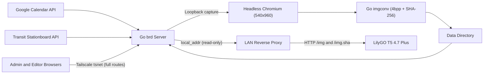
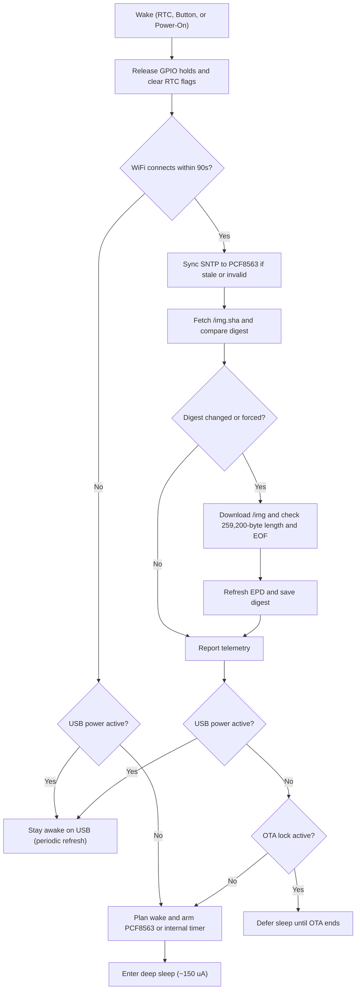

# brd

`brd` is an e-paper wall display for the LilyGO T5 4.7-inch Plus board.
It pairs a Go rendering server with ESPHome firmware that draws about 150 uA in deep sleep.

## Architecture

The Go server renders a daily dashboard with Google Calendar events, sanitized rich-text notes, weather, and transit departures.
A persistent headless Chromium browser captures the `#screenshot_content` frame (`540x960` pixels).
The `internal/imgconv` package packs the frame into a 4-bit grayscale framebuffer (`259,200` bytes) and a SHA-256 digest in pure Go.
The ESP32-S3 display wakes on a wall-clock schedule, checks `/img.sha` for changes, downloads changed frames, and enters deep sleep.



> [!NOTE]
> The server isolates its two HTTP listeners by role.
> `local_addr` binds only to loopback (`127.0.0.1`, `[::1]`, or `localhost`) and mounts `ReadOnlyHandler`.
> `ReadOnlyHandler` serves only display and asset routes for headless Chromium and a local reverse proxy that serves the LAN display.
> `local_addr` never serves `/edit`, `/update`, `/newtoken`, or `/savetoken`.
> The Tailscale `tsnet` listener (`tailnet_addr`) mounts `Handler` to serve the full authenticated interface for browsers and tagged proxies.

### Design Rationale

- **Single-binary deployment:** `internal/web` embeds HTML templates and CSS with `go:embed`, so the compiled binary needs no external template directory.
- **Pure-Go image conversion:** `internal/imgconv` crops, rotates, converts to 4bpp grayscale, and hashes PNG captures without ImageMagick or Python.
- **Dual-listener isolation:** Keeping display reads on a read-only loopback listener separates LAN display traffic from authenticated Tailscale admin and editor routes.
- **Persistent browser reuse:** `ChromedpFactory` keeps one headless Chromium process running across capture cycles and opens a new tab for each capture.

## Go Server

The server lives in `cmd/brd` and `internal/*` under module `github.com/neoautomata/brd`.

### Server Packages

| Package | Responsibility |
| :--- | :--- |
| `cmd/brd` | CLI entry point, signal handling, lifecycle of both HTTP servers, and periodic regeneration |
| `internal/config` | Strict JSON loading, path canonicalization, and boundary checks |
| `internal/auth` | Tailscale `WhoIs` or tagged proxy-header identity checks and role enforcement |
| `internal/timeutil` | Timezone-aware prior-day checks and elapsed-time formatting |
| `internal/sanitize` | Allowlist HTML and CSS sanitizer with SSRF-hardened rules for image URLs |
| `internal/calendar` | Google Calendar OAuth2 flow with PKCE, atomic token storage, and event rendering |
| `internal/transit` | Cached stationboard HTTP client with stale fallback and departure formatting |
| `internal/capture` | Headless Chromium (`chromedp`) screenshot capture, conversion, and retention |
| `internal/imgconv` | Pure-Go 540x960 center-crop, ITU-R 601-2 grayscale, 90° CCW rotation, and 4bpp packing |
| `internal/atomicfile` | Synced temporary-file and rename helper for atomic writes |
| `internal/web` | HTTP routers (`Handler` and `ReadOnlyHandler`), embedded templates, and CSRF protection |

### HTTP API

| Route | Method | Listener | Access | Purpose |
| :--- | :--- | :--- | :--- | :--- |
| `/` | `GET` | `local_addr`, `tsnet` | Public | Render the dashboard for today or `?date=YYYY-MM-DD` |
| `/ckengine5.css` | `GET` | `local_addr`, `tsnet` | Public | Serve embedded CKEditor content styles |
| `/img`, `/img.sha` | `GET` | `local_addr`, `tsnet` | Public | Serve today's 4bpp framebuffer and SHA-256 digest |
| `/img2`, `/img2.sha` | `GET` | `local_addr`, `tsnet` | Public | Serve tomorrow's 4bpp framebuffer and SHA-256 digest |
| `/screenshot`, `/screenshot2` | `GET` | `local_addr`, `tsnet` | Public | Serve cropped PNG screenshots for today and tomorrow |
| `/window_screenshot` | `GET` | `local_addr`, `tsnet` | Public | Serve the full PNG screenshot of the browser for today |
| `/edit` | `GET` only | `tsnet` only | Editor or Admin | Open the CKEditor note form and issue a CSRF token |
| `/update` | `POST` only | `tsnet` only | Editor or Admin | Check CSRF token, sanitize HTML, save note, and regenerate image |
| `/newtoken` | `GET` only | `tsnet` only | Admin | Redirect to Google OAuth2 with a random state token and PKCE |
| `/savetoken` | `GET` only | `tsnet` only | Admin | Check OAuth2 state, exchange code, and write `token.json` |

- **Date limits:** `/`, `/edit`, and `/update` reject prior days and dates more than 365 days ahead (`400`).
- **Update limits:** `/update` rejects request bodies larger than 1 MiB (`413`).
- **Immediate regeneration:** `/update` regenerates the display image immediately (with a 25-second timeout) only when the target date is today or tomorrow.
- **Strict `GET`-only guards:** `/edit`, `/newtoken`, and `/savetoken` reject `HEAD` requests with `405 Method Not Allowed` to prevent side effects.

### Installation and First-Run Setup

Install Go 1.27.4 or newer and Chromium or Chrome.
Install optional `g++` for firmware host tests and `esphome` (`>= 2026.3.0`) for flashing firmware.

Run the idempotent installer script to check prerequisites, run tests, build `./cmd/brd`, and install the binary:

```bash
./install.sh --init-config
```

The installer supports these flags:

| Flag | Purpose |
| :--- | :--- |
| `--prefix DIR` | Set the install directory (defaults to `/usr/local/bin` if root or writable, else `$HOME/.local/bin`) |
| `--init-config` | Copy `config.example.json` to `config.json` with mode `0600` if `config.json` does not exist |
| `--check-only` | Check Go and Chromium prerequisites and exit without building |
| `--skip-tests` | Skip `go vet ./...` and `go test -race ./...` before building |

`install.sh` honors the `CHROME_PATH` environment variable when checking browser availability.

You can also run tests and build the binary manually:

```bash
go vet ./...
go test -race -cover ./...
go build -o /tmp/brd ./cmd/brd
```

Complete these steps before starting `brd`:

1. Edit `config.json` with your deployment values (see Server Configuration).
1. Pass the config file via `-config` or `BRD_CONFIG` (`-config` overrides `BRD_CONFIG`, which overrides `./config.json`).
1. Start `brd`. Enroll the `tsnet` node with `TS_AUTHKEY`, or open the Tailscale login URL in the server logs.
1. Enable the Google Calendar API in Google Cloud.
1. Create an OAuth 2.0 Web client with `https://<your-host>/savetoken` (or `http://<tailnet_hostname>/savetoken`) as a redirect URI.
1. Save the OAuth client JSON file to `<data_dir>/client_secret.json` with mode `0600`.
1. Open `/newtoken` as an admin user over Tailscale `tsnet` to authorize read-only calendar access and write `<data_dir>/token.json`.

### Server Configuration

`internal/config` decodes JSON with `DisallowUnknownFields` and rejects unknown keys or trailing data.
The loader resolves a relative `data_dir` path against the directory that contains the config file.

| Field | Default | Purpose |
| :--- | :--- | :--- |
| `data_dir` | Required | Root directory for notes, screenshots, images, tokens, and Tailscale state |
| `timezone` | `"UTC"` | IANA timezone for dates, calendar bounds, and transit times |
| `tailnet_hostname` | `"brd"` | Lowercase hostname on the Tailscale tailnet (1 to 63 characters) |
| `tailnet_addr` | `":80"` | Listen address on the `tsnet` listener |
| `local_addr` | `"127.0.0.1:1234"` | Loopback-only listen address (`127.0.0.1`, `[::1]`, or `localhost`) |
| `trust_webauth_header` | `false` | Accept `X-Webauth-User` from tagged Tailscale proxies (requires non-empty `trusted_proxy_tags`) |
| `trusted_proxy_tags` | `[]` | Tailscale `tag:*` ACL tags allowed to send `X-Webauth-User` (rejected when `trust_webauth_header` is `false`) |
| `chrome_path` | `""` | Optional path to the Chromium or Chrome binary (auto-detects when empty) |
| `chrome_no_sandbox` | `false` | Pass `--no-sandbox` to Chromium (enable only in restricted containers) |
| `regen_interval_seconds` | `300` | Seconds between scheduled image regenerations (1 to 604,800) |
| `retention_days` | `7` | Days to retain dated notes, screenshots, and images (1 to 3,650) |
| `admin_users` | `[]` | Email addresses allowed to edit notes and run `/newtoken` and `/savetoken` |
| `editor_users` | `[]` | Email addresses allowed to open `/edit` and submit `/update` |
| `calendars` | `[]` | Google Calendar IDs queried for daily events |
| `transit` | `{}` | Public transit settings (`cache_duration_seconds`: `600`, `max_departures`: `4`) |
| `weather_widget_html` | `""` | Optional raw HTML snippet rendered inside `#screenshot_content` |

<details>
<summary>Nested <code>transit</code> configuration keys</summary>

| Key | Default | Purpose |
| :--- | :--- | :--- |
| `stationboard_url` | `""` | HTTP or HTTPS stationboard endpoint URL (empty disables transit) |
| `cache_duration_seconds` | `600` | Cache lifetime in seconds (1 to 86,400) |
| `excluded_stop_id` | `""` | Next-stop ID (`passList[1]`) used to exclude one travel direction |
| `excluded_stop_name` | `""` | Next-stop name (`passList[1]`) used to exclude one travel direction |
| `lines` | `[]` | Transit line numbers to include |
| `max_departures` | `4` | Maximum departures per line (positive integer) |

</details>

> [!CAUTION]
> The server renders `weather_widget_html` as raw HTML and scripts without sanitization.
> Place only trusted markup in `weather_widget_html`.

## ESPHome Firmware

The firmware in `firmware/` targets the LilyGO T5 4.7-inch Plus display and requires ESPHome `>= 2026.3.0`.

### Hardware Architecture

The board combines an ESP32-S3 microcontroller (16 MB flash, 8 MB octal PSRAM) with an ED047TC1 grayscale panel (4bpp, `960x540` native, `540x960` at `270°` rotation).
A 74HCT4094D shift register (`U3`) controls display rails and switches the LT1945 boost converter and battery divider through `PWR_EN` (`QP5`).
A Goodix GT911 touch controller and a PCF8563 real-time clock (`0x51`) share the I2C bus.

### Wake Cycle

On battery power, the `max_battery_awake_sec` failsafe (default `180` seconds) forces deep sleep unless an active OTA or image sleep lock holds sleep.



The firmware uses `/img.sha` strictly for change detection.
It normalizes the 64-character hex string from `/img.sha` and compares it against `rtc_state.last_img_hash`.
When both values match, the firmware skips downloading `/img`.
To save CPU time and battery power, the ESP32-S3 does not calculate a SHA-256 digest on downloaded `/img` bytes.
During a download, the firmware writes `/img` to a PSRAM staging buffer.
It checks exact byte length (`259,200` bytes) and EOF before copying that buffer into the framebuffer.

### Sleep Power Budget

The firmware reduces deep-sleep current to about 150 uA through four controls:

1. Write `0x05` to GT911 register `0x8040` and hold `GPIO 47` low during sleep.
1. Disable the 32.768 kHz square wave on PCF8563 pin `CLKOUT`.
1. Hold shift-register inputs (`GPIO 12`, `GPIO 13`) low and configure `GPIO 0` as an RTC pull-up input.
1. Disable USB serial JTAG pull-ups in `on_shutdown` after logs flush.

| Operating Mode | Current Draw | Daily Active Duration | Daily Energy |
| :--- | :--- | :--- | :--- |
| Deep Sleep | 150 uA | 23.96 hours | 3.59 mAh |
| Network and Refresh | 95 mA | 132 seconds | 3.48 mAh |
| **Total** | | | **7.07 mAh/day** |

A 2500 mAh battery delivers 353 days of runtime under full refreshes, or 440 to 525 days when digest matches skip 75% of refreshes.

### Wall-Clock Scheduler

The scheduler runs in `local_timezone` (default `UTC`) with `EspHomeTzCalendar`, avoiding `setenv("TZ")` calls.
During daytime (`07:00` to `22:00` by default), the display wakes on quarter-hour marks (`:00`, `:15`, `:30`, `:45`) with a 120-second lead margin.
At bedtime, the scheduler sets the next wake target to the following morning and the display sleeps overnight.

Before deep sleep, the firmware enforces a minimum sleep floor of 60 seconds and arms wake timers in this order:

1. Arm the PCF8563 hardware alarm when the sleep duration lies in `[90, 86,100)` seconds and no RTC clock-save failure occurred.
1. Use the PCF8563 countdown timer outside `[90, 86,100)` seconds or after an RTC clock-save failure (clamping timer counts at 15,300 seconds).
1. Arm the internal deep-sleep timer on the ESP32-S3 if PCF8563 wake arming fails.

### Firmware Build and Configuration

`firmware/brd-cfg.yaml` includes `brd/firmware/brd-tmpl.yaml` and expects this repository directory to carry the name `brd/`.

Complete these steps from the `brd/` directory:

1. Copy `firmware/brd-cfg.yaml` to `../brd.yaml`.
1. Edit `../brd.yaml` to set `image_url_raw`, `image_url_raw_sha`, `local_timezone`, and `wifi.networks[].manual_ip`.
1. Create `../secrets.yaml` with your WiFi, web, and OTA passwords.
1. Compile the firmware with ESPHome `>= 2026.3.0`.
1. Flash the board with ESPHome `>= 2026.3.0`.

```bash
cp firmware/brd-cfg.yaml ../brd.yaml
esphome compile ../brd.yaml
esphome run ../brd.yaml
```

Use this format for `../secrets.yaml`:

```yaml
wifi_ssid: "your-wifi-ssid"
wifi_password: "your-wifi-password"
web_password: "your-device-web-password"
ota_password: "your-device-ota-password"
```

<details>
<summary>All firmware substitution variables (defaults from <code>firmware/brd-tmpl.yaml</code>)</summary>

| Variable | Default | Purpose |
| :--- | :--- | :--- |
| `name` | `brd` | ESPHome device name and telemetry job label |
| `brd_dir` | `brd/firmware` | Path to C++ header files for the firmware relative to `brd.yaml` |
| `short_sleep_time` | `15` | Interval in minutes between daytime wake boundaries |
| `sleep_at_hr` | `22` | Bedtime hour in `local_timezone` (0 to 23) |
| `sleep_at_min` | `0` | Bedtime minute in `local_timezone` (0 to 59) |
| `wake_at_hr` | `7` | Morning wake hour in `local_timezone` (0 to 23) |
| `wake_at_min` | `0` | Morning wake minute in `local_timezone` (0 to 59) |
| `min_awake_sec` | `30` | Minimum awake seconds after a button wake |
| `max_battery_awake_sec` | `180` | Battery max-awake failsafe in seconds |
| `usb_refresh_interval_min` | `5` | Periodic refresh interval in minutes while on USB power |
| `periodic_refresh_after_sec` | `240` | Uptime seconds before USB periodic refreshes start |
| `wifi_connect_timeout_sec` | `90` | WiFi watchdog timeout before entering deep sleep on battery |
| `rtc_i2c_addr` | `0x51` | PCF8563 I2C bus address |
| `wifi_output_power` | `12.0` | WiFi output power in dBm |
| `local_timezone` | `UTC` | Timezone for wall-clock scheduling and RTC conversion |
| `ntp_server` | `""` | Optional primary SNTP server (replaces slot 0 while keeping `1.pool.ntp.org` and `2.pool.ntp.org`) |
| `image_url_raw` | `""` | HTTP URL for the packed 4bpp framebuffer (`/img`) |
| `image_url_raw_sha` | `""` | HTTP URL for the `/img.sha` change-detection digest (64 hex characters) |
| `vlogs_host` | `""` | Optional VictoriaLogs base URL for per-wake JSONLine logs |
| `vmetrics_host` | `""` | Optional VictoriaMetrics base URL for per-wake Prometheus metrics |

</details>

> [!TIP]
> Connect the board over USB when flashing, reading serial logs, or running OTA updates.
> When the firmware detects USB serial activity or USB charging voltage, the display skips deep sleep and refreshes every `usb_refresh_interval_min` minutes.

### Firmware Host Tests

Run the C++20 unit and race test suites with AddressSanitizer, UndefinedBehaviorSanitizer, and ThreadSanitizer:

```bash
g++ -std=c++20 -O2 -Wall -Wextra -Werror -fsanitize=address,undefined -pthread \
  firmware/tests/test_brd.cpp -o /tmp/test_brd_asan && \
  /tmp/test_brd_asan && rm -f /tmp/test_brd_asan

g++ -std=c++20 -O2 -Wall -Wextra -Werror -fsanitize=thread -pthread \
  firmware/tests/test_brd.cpp -o /tmp/test_brd_tsan && \
  /tmp/test_brd_tsan && rm -f /tmp/test_brd_tsan
```

## Troubleshooting

<details>
<summary>Common failure modes and fixes</summary>

| Symptom | Cause | Fix |
| :--- | :--- | :--- |
| Dashboard prints `Calendar unavailable` | Missing or expired OAuth2 token or missing `client_secret.json` | Save `client_secret.json` (`0600`) in `data_dir` and visit `/newtoken` as an admin over `tsnet` |
| Server exits with `decode config JSON` | Unknown JSON field or trailing bytes in `config.json` | Delete unknown keys and check JSON syntax (`DisallowUnknownFields` rejects typos) |
| Server exits with `must use a loopback host` | Non-loopback host in `local_addr` | Bind `local_addr` to `127.0.0.1`, `[::1]`, or `localhost` and place a reverse proxy in front for LAN displays |
| Server exits on `trust_webauth_header` | Mismatch between `trust_webauth_header` and `trusted_proxy_tags` | Add at least one `tag:*` entry to `trusted_proxy_tags` when `true`, or empty the list when `false` |
| Headless capture fails to start | Missing Chromium binary or container sandbox restriction | Install Chromium or set `chrome_path`. Enable `chrome_no_sandbox: true` only in restricted containers |
| `401 Unauthorized` or `403 Forbidden` on `/edit` or `/newtoken` | Missing Tailscale identity, untrusted tagged node, or user not in role list | Connect over `tsnet`, add the email to `editor_users` or `admin_users`, and tag any reverse proxy in `trusted_proxy_tags` |
| Display never enters deep sleep | USB keep-awake detects USB serial activity or charging voltage | Disconnect USB power to return to the scheduled deep-sleep cycle |

</details>

## Security Model

- **Loopback read-only isolation:** `local_addr` accepts only loopback hosts and mounts `ReadOnlyHandler`, excluding all edit and OAuth2 routes.
- **Fail-closed Tailscale authentication:** `TailscaleResolver` authenticates direct peers through `WhoIs` and rejects untrusted tagged nodes. Enabling `trust_webauth_header` requires non-empty `trusted_proxy_tags` and rejects multi-value or control-character `X-Webauth-User` headers.
- **Reverse-proxy hygiene:** Configure any `tsnet` reverse proxy to overwrite client-supplied `X-Webauth-User` headers. Expose only `/img` and `/img.sha` to the LAN display.
- **HTML sanitization and SSRF limits:** `internal/sanitize` strips scripts, iframes, SVGs, forms, event handlers, and unsafe CSS. It allows `` only for base64-encoded raster images in `data:` URIs (`png`, `jpeg`, `gif`, `webp`) or public `https:` hostnames. It rejects IP literals, `localhost`, `.local`, `.internal`, single-label hosts, and URL credentials.
- **Trusted weather markup:** Treat `weather_widget_html` as trusted server config because the server renders it without sanitization.
- **File and directory permissions:** The server enforces mode `0700` on `data_dir` and its subdirectories and writes notes and tokens atomically with mode `0600`. It warns if `client_secret.json` or `token.json` allows group or world access.
- **Chromium sandbox:** `chrome_no_sandbox` defaults to `false`, keeping the Chromium sandbox active outside restricted containers.
- **CSRF and OAuth2 state tokens:** `/update` requires a single-use, user-bound CSRF token (2-hour TTL), and `/savetoken` checks a single-use OAuth2 state token with PKCE.
- **Firmware image downloads:** The firmware uses `/img.sha` only as a change-detection digest, not as a security integrity check. The ESP32-S3 does not calculate a SHA-256 digest on downloaded `/img` bytes. On download, the firmware checks only exact byte length (`259,200` bytes) and EOF before copying the PSRAM staging buffer into the framebuffer.
- **Secrets management:** Store WiFi, web, and OTA passwords in `secrets.yaml` outside version control.

> [!WARNING]
> ESPHome `web_server` uses HTTP Basic authentication on port 80, and the display fetches `/img` and `/img.sha` over plain HTTP.
> Isolate the display on a trusted local VLAN.
