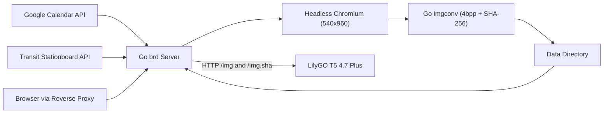

# brd

`brd` is an e-paper wall display for the LilyGO T5 4.7-inch Plus board.
It combines a Go rendering server with ESPHome firmware for ultra-low-power daily operation.

## Architecture

The Go server renders a daily dashboard that combines Google Calendar events, sanitized rich-text notes, weather, and public transit departures.
A headless Chromium browser captures the `#screenshot_content` frame (`540x960` pixels).
The `internal/imgconv` package packs the frame into a 4-bit grayscale framebuffer and a SHA-256 digest in pure Go.
The ESP32-S3 device wakes on a wall-clock schedule, checks the digest, downloads changed frames, and returns to deep sleep.



> [!NOTE]
> The display connects over local HTTP for `/img` and `/img.sha`.
> Editors and administrators reach `/edit`, `/update`, `/newtoken`, and `/savetoken` through a reverse proxy (local or Tailscale) or directly over Tailscale.

## Go Server

The server lives in `cmd/brd` and `internal/*` under module `github.com/neoautomata/brd`.

### Server Packages

| Package | Responsibility |
| :--- | :--- |
| `cmd/brd` | CLI entry point, signal handling, HTTP server lifecycles, and periodic regeneration |
| `internal/config` | JSON config loading, path canonicalization, and boundary validation |
| `internal/auth` | Tailscale `WhoIs` or opt-in proxy-header identity checks and role enforcement |
| `internal/timeutil` | Timezone-aware prior-day checks and calendar elapsed-time formatting |
| `internal/sanitize` | Allowlist HTML sanitizer for CKEditor note submissions |
| `internal/calendar` | Google Calendar OAuth2 flow, atomic token storage, and event HTML rendering |
| `internal/transit` | Cached stationboard HTTP client with stale fallback and departure formatting |
| `internal/capture` | Headless ChromeDriver screenshot orchestration, 4bpp conversion, and file retention |
| `internal/imgconv` | Pure-Go 540x960 center-crop, ITU-R 601-2 grayscale, 90° CCW rotation, and 4bpp packing |
| `internal/atomicfile` | Synced temporary-file and rename helper for atomic writes |
| `internal/web` | Dedicated HTTP router, embedded templates, CSRF protection, and asset handlers |

### HTTP Endpoints

| Route | Method | Access | Purpose |
| :--- | :--- | :--- | :--- |
| `/` | `GET` | Public | Render the daily dashboard for today or `?date=YYYY-MM-DD` |
| `/ckengine5.css` | `GET` | Public | Serve embedded CKEditor content styles |
| `/edit` | `GET` | Editor or Admin | Open the CKEditor note form for a date |
| `/update` | `POST` | Editor or Admin | Check CSRF token, sanitize note HTML, save note, and regenerate image |
| `/newtoken` | `GET` | Admin | Redirect to Google OAuth2 with a random state token |
| `/savetoken` | `GET` | Admin | Check OAuth2 state, exchange code, and store `token.json` |
| `/img`, `/img.sha` | `GET` | Public | Serve today's 4bpp framebuffer and SHA-256 digest |
| `/img2`, `/img2.sha` | `GET` | Public | Serve tomorrow's 4bpp framebuffer and SHA-256 digest |
| `/screenshot`, `/screenshot2` | `GET` | Public | Serve cropped PNG screenshots for today and tomorrow |
| `/window_screenshot` | `GET` | Public | Serve the full browser PNG screenshot for today |

### Server Configuration

Copy `config.example.json` to `config.json` and edit all deployment values.
Pass the file path through `-config` or the `BRD_CONFIG` environment variable.

```bash
cp config.example.json config.json
```

| Field | Default | Purpose |
| :--- | :--- | :--- |
| `data_dir` | Required | Root directory for notes, screenshots, images, tokens, and Tailscale state |
| `timezone` | `"UTC"` | IANA timezone for dates, calendar bounds, and transit times |
| `tailnet_hostname` | `"brd"` | Hostname registered on the Tailscale tailnet |
| `tailnet_addr` | `":80"` | Listen address on the `tsnet` listener |
| `local_addr` | `"127.0.0.1:1234"` | Loopback address for headless Chromium, local HTTP, and optional local proxy traffic |
| `trust_webauth_header` | `false` | Accept `X-Webauth-User` from a local or Tailscale reverse proxy |
| `trusted_proxy_tags` | `[]` | Restrict `X-Webauth-User` on the Tailscale listener to peers with these `tag:*` ACL tags |
| `chromedriver_path` | `"/usr/bin/chromedriver"` | Path to the ChromeDriver binary |
| `chromedriver_port` | `4444` | Loopback port for ChromeDriver |
| `regen_interval_seconds` | `300` | Seconds between scheduled screenshot regenerations |
| `retention_days` | `7` | Days to retain dated notes, screenshots, and images |
| `admin_users` | `[]` | Email addresses allowed to edit notes and refresh OAuth2 tokens |
| `editor_users` | `[]` | Email addresses allowed to open `/edit` and submit `/update` |
| `calendars` | `[]` | Google Calendar IDs queried for daily events |
| `transit` | `{}` | Stationboard URL, cache seconds, excluded stop ID or name, line numbers, and `max_departures` (default `4`) |
| `weather_widget_html` | `""` | Optional HTML snippet for the weather widget inside `#screenshot_content` |

> [!IMPORTANT]
> On the Tailscale listener, `trusted_proxy_tags` restricts `X-Webauth-User` to tagged proxy peers while other peers use `WhoIs`.
> On `local_addr`, bind to loopback so only a local reverse proxy can send `X-Webauth-User`.

### Server Build and Test

Install Go 1.27 or later, Chromium, and `chromium-driver`.

Run unit and race tests across all Go packages:

```bash
go vet ./...
go test -race -cover ./...
```

Build and run the server locally:

```bash
go build -o /tmp/brd ./cmd/brd
/tmp/brd -config ./config.json
```

## ESPHome Firmware

The firmware in `firmware/` targets the LilyGO T5 4.7-inch Plus display.

### Hardware Architecture

The board integrates an ESP32-S3 microcontroller (16 MB flash, 8 MB octal PSRAM) with an ED047TC1 4-bit grayscale display (`960x540` native, `540x960` at `270°` rotation).
A 74HCT4094D shift register (`U3`) controls display rails and switches the LT1945 boost converter and battery voltage divider through `PWR_EN` (`QP5`).
A Goodix GT911 touch controller and a PCF8563 real-time clock (`0x51`) share the I2C bus.

### Sleep Power Budget

The firmware reduces deep sleep current to about 150 microamperes through four controls:

1. Write `0x05` to GT911 register `0x8040` and hold `GPIO 47` low during sleep.
1. Disable the 32.768 kHz square wave on PCF8563 pin `CLKOUT`.
1. Hold shift-register inputs (`GPIO 12`, `GPIO 13`) low and configure `GPIO 0` as an RTC pull-up input.
1. Disable USB serial JTAG pull-ups in `on_shutdown` after logs flush.

| Operating Mode | Current Draw | Daily Active Duration | Daily Energy |
| :--- | :--- | :--- | :--- |
| Deep Sleep | 150 uA | 23.96 hours | 3.59 mAh |
| Network and Refresh | 95 mA | 132 seconds | 3.48 mAh |
| **Total** | | | **7.07 mAh/day** |

A 2500 mAh battery delivers 353 days of runtime under full refreshes, or 440 to 525 days when digest matches skip 75% of redraws.

### Wall-Clock Scheduler

The scheduler operates in `local_timezone` (default `UTC`) using `EspHomeTzCalendar` so daylight saving shifts require no `setenv("TZ")` calls.
During daytime (`07:00` to `22:00` by default), the device wakes on quarter-hour marks (`:00`, `:15`, `:30`, `:45`) with a 120-second lead margin.
At bedtime, the device arms the PCF8563 hardware alarm for the next morning wake and sleeps all night.

### Firmware Build and Test

Copy `firmware/brd-cfg.yaml` next to the `brd/` directory as `brd.yaml` and complete `secrets.yaml`.

```bash
cp firmware/brd-cfg.yaml ../brd.yaml
esphome compile ../brd.yaml
esphome run ../brd.yaml
```

Run host C++20 unit and race tests with AddressSanitizer and ThreadSanitizer:

```bash
g++ -std=c++20 -O2 -Wall -Wextra -Werror -fsanitize=address,undefined \
  firmware/tests/test_brd.cpp -o /tmp/test_brd_asan && \
  /tmp/test_brd_asan && rm -f /tmp/test_brd_asan

g++ -std=c++20 -O2 -Wall -Wextra -Werror -fsanitize=thread -pthread \
  firmware/tests/test_brd.cpp -o /tmp/test_brd_tsan && \
  /tmp/test_brd_tsan && rm -f /tmp/test_brd_tsan
```

## Security Model

- Keep OAuth2 secrets (`client_secret.json`, `token.json`) inside `data_dir` with `0600` permissions.
- Store WiFi and device admin passwords in `secrets.yaml`, outside version control.
- Bind the local HTTP server to `127.0.0.1` so unauthenticated local endpoints stay off external interfaces.
- Sanitize all CKEditor note HTML before storing and rendering it.
- Enforce single-use CSRF tokens on `/update` and single-use OAuth2 state tokens on `/savetoken`.

> [!WARNING]
> ESPHome `web_server` uses HTTP Basic authentication on port 80.
> Isolate the display on a trusted local VLAN.
